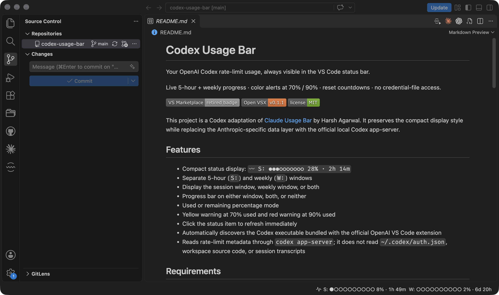

# Codex Usage Bar

Your OpenAI Codex rate-limit usage, always visible in the VS Code status bar.

Live 5-hour + weekly progress · color alerts at 70% / 90% · reset countdowns · no credential-file access.

[](https://marketplace.visualstudio.com/items?itemName=luizgununes.codex-usage-bar-vscode)
[](https://open-vsx.org/extension/luizgununes/codex-usage-bar-vscode)
[](LICENSE)



This project is a Codex adaptation of [Claude Usage Bar](https://github.com/Harsh1210/claude-usage-bar) by Harsh Agarwal. It preserves the compact display style while replacing the Anthropic-specific data layer with the official local Codex app-server.

## Features

- Compact status display: `〰 S: ●●●○○○○○○○ 28% · 2h 14m`
- Separate 5-hour (`S:`) and weekly (`W:`) windows
- Display the session window, weekly window, or both
- Progress bar on either window, both, or neither
- Used or remaining percentage mode
- Yellow warning at 70% used and red warning at 90% used
- Click the status item to refresh immediately
- Automatically discovers the Codex executable bundled with the official OpenAI VS Code extension
- Reads rate-limit metadata through `codex app-server`; it does not read `~/.codex/auth.json`, workspace source code, or session transcripts

## Requirements

- VS Code 1.85 or newer
- The official Codex CLI or OpenAI VS Code extension, signed in to Codex

If the executable is not found automatically, set `codexUsageBar.codexPath` to its absolute path.

## Install

Install from the [Visual Studio Marketplace](https://marketplace.visualstudio.com/items?itemName=luizgununes.codex-usage-bar-vscode) or [Open VSX](https://open-vsx.org/extension/luizgununes/codex-usage-bar-vscode).

To build and install locally:

```bash
npm install
npm test
npm run package
code --install-extension codex-usage-bar-vscode-0.1.1.vsix
```

## Settings

| Setting | Values | Default | Description |
| --- | --- | --- | --- |
| `codexUsageBar.displayMode` | `session`, `weekly`, `both` | `session` | Which limit appears in the status bar |
| `codexUsageBar.progressBar` | `both`, `session`, `weekly`, `none` | `both` | Which limits show the circle bar |
| `codexUsageBar.percentageMode` | `used`, `remaining` | `used` | Meaning of the displayed percentage |
| `codexUsageBar.showProviderLabel` | `true`, `false` | `false` | Optionally show `Codex` next to the provider icon |
| `codexUsageBar.alignment` | `left`, `right` | `left` | Choose the left or right status group |
| `codexUsageBar.leftPosition` | `normal`, `farLeft` | `normal` | Optionally place Codex before Git and other left-side items |
| `codexUsageBar.codexPath` | executable path | `codex` | Path to the official Codex executable |
| `codexUsageBar.refreshIntervalSeconds` | number ≥ 15 | `60` | Account usage refresh interval |

To keep both limits visible:

```json
{
  "codexUsageBar.displayMode": "both",
  "codexUsageBar.progressBar": "both",
  "codexUsageBar.alignment": "left",
  "codexUsageBar.leftPosition": "farLeft"
}
```

## Commands

- `Codex Usage: Refresh Rate Limit`
- `Codex Usage: Switch Display Mode (5h / Weekly / Both)`
- `Codex Usage: Open Usage Page`

## Privacy

The extension starts the official local `codex app-server`, performs a JSON-RPC handshake, requests `account/rateLimits/read`, renders the returned quota metadata, and terminates the child process. Authentication remains inside Codex.

## License

MIT. See the `LICENSE` file. The original Claude Usage Bar copyright and license notice are preserved.

## Acknowledgements

Codex Usage Bar is derived from [Claude Usage Bar](https://github.com/Harsh1210/claude-usage-bar) by Harsh Agarwal. The compact status-bar design and original project structure provided the foundation for this Codex adaptation.
